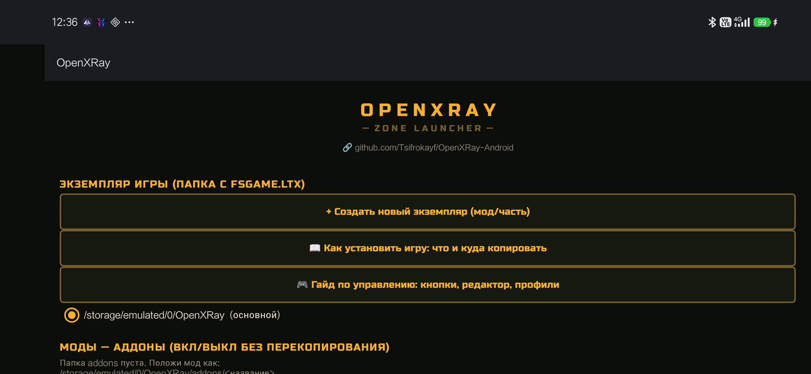
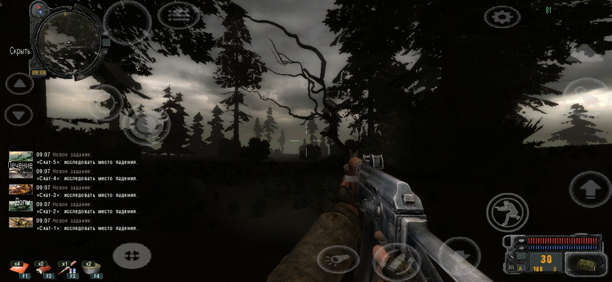
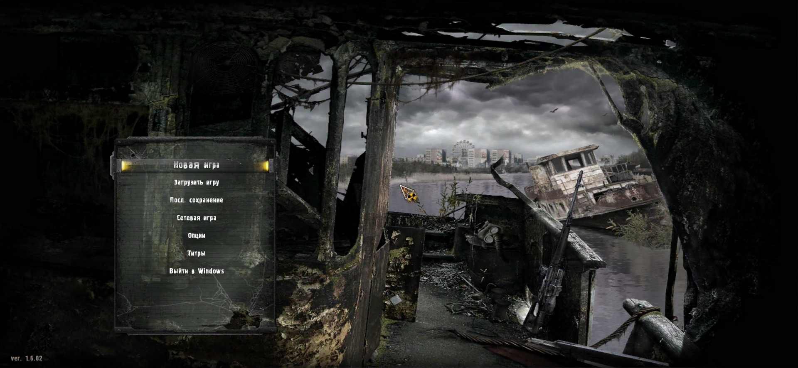
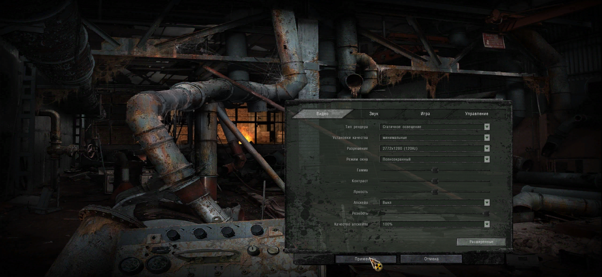
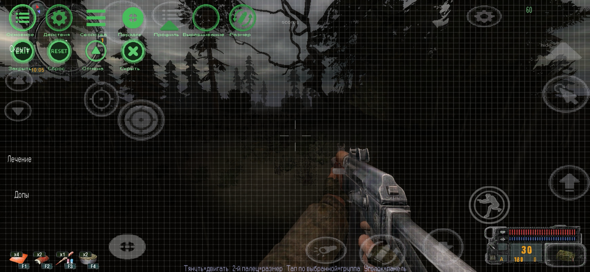

# OpenXRay — Android

**Android-порт движка [OpenXRay](https://github.com/OpenXRay/xray-16)** (открытая реализация X-Ray) для игр серии S.T.A.L.K.E.R.

Портируется под телефон/планшет (arm64): свой лаунчер, тач-управление с редактором, апскейл картинки и настройка масштаба рендера для слабых устройств.

> Исходный код порта пока не публикуется — репозиторий содержит только релизы, скриншоты и описание. Баги и пожелания — в [Issues](https://github.com/Tsifrokayf/OpenXRay-Android/issues).

## Скриншоты

| Лаунчер | Геймплей |
|---|---|
|  |  |

| Меню | Настройки видео |
|---|---|
|  |  |

| Редактор тач-зон |
|---|
|  |

## Возможности

- 🎮 **Лаунчер (Zone Launcher)** — экземпляры игры, моды/аддоны (вкл/выкл без перекопирования), разрешение рендера, выбор GL-драйвера (системный OpenGL ES / ANGLE), апскейл, VSync, сбор диагностики.
- 🕹 **Тач-управление** — настраиваемые зоны и профили раскладок; встроенный **редактор**: жест «тянуть» двигает зону, «2-й палец» (пинч) меняет размер, тап по выбранной зоне группирует, уголок зоны открывает панель свойств.
- 🖼 **Апскейл** — FSR 1.0 (AMD) и SGSR (Qualcomm) + «Качество апскейла» (масштаб рендера 25–100%); при выключённом апскейле — биллинейный фильтр.
- ⚡ **Производительность** — масштаб рендера для слабых устройств (25–75%), отключение мелких теней, опциональный VSync.

## Установка

1. Скачайте `OpenXRay-Android-v0.1.0.apk` из [Releases](https://github.com/Tsifrokayf/OpenXRay-Android/releases/latest) и установите (нужно разрешение «Установка из неизвестных источников»).
2. Скопируйте **файлы вашей установленной игры** (оригинальные, покупные) в память телефона:
   ```
   /storage/emulated/0/OpenXRay/
   ├── fsgame.ltx          ← конфиг экземпляра игры
   └── gamedata/           ← уровны, текстуры, звук, конфиги игры
   ```
   В APK входят движок, лаунчер и служебные ассеты (шейдеры, интерфейс) — **контент игры не входит**.
3. Откройте приложение **OpenXRay** → проверьте путь экземпляра → **▶ ИГРАТЬ**.

Внутри лаунчера есть кнопки «Как установить игру» и «Гайд по управлению».
4. файлы игры для ознакомления https://drive.google.com/file/d/1e7_vt0-z1sHGrYO5t80L8ZHtJ1cTVQZy/view?usp=drivesdk
## Системные требования

- Android 9.0+ (API 28), arm64
- ~2 ГБ свободной памяти (APK + игра)
- Рекомендуется: разрешение рендера 50% — на большинстве телефонов полное разрешение тяжело

---

# OpenXRay — Android

**An Android port of the [OpenXRay](https://github.com/OpenXRay/xray-16) engine** (open-source X-Ray implementation) for the S.T.A.L.K.E.R. series.

Ported to phones/tablets (arm64): custom launcher, editable touch controls, upscaling and render-scale options for lower-end devices.

> Port source code is not published yet — this repository carries releases, screenshots and docs only. Bugs and requests go to [Issues](https://github.com/Tsifrokayf/OpenXRay-Android/issues).

## Features

- 🎮 **Zone Launcher** — game instances, mods/addons (toggle without re-copying), render resolution, GL driver choice (stock OpenGL ES / ANGLE), upscaler, VSync, diagnostics dump.
- 🕹 **Touch controls** — configurable zones and layout profiles; built-in **editor**: drag to move a zone, pinch (two fingers) to resize, tap the selected zone to group it, tap its corner to open the property panel.
- 🖼 **Upscaling** — FSR 1.0 (AMD) and SGSR (Qualcomm) plus "Upscale quality" (render scale 25–100%); bilinear filtering when upscaling is off.
- ⚡ **Performance** — render scale for weaker devices (25–75%), optional VSync, small-light shadow toggle.

## Install

1. Grab `OpenXRay-Android-v0.1.0.apk` from [Releases](https://github.com/Tsifrokayf/OpenXRay-Android/releases/latest) and sideload it.
2. Copy **your legally owned game files** to device storage:
   ```
   /storage/emulated/0/OpenXRay/
   ├── fsgame.ltx      ← game instance config
   └── gamedata/       ← levels, textures, sounds, game configs
   ```
   The APK ships the engine, launcher and support assets (shaders, UI) — **game content is not included**.
3. Open the **OpenXRay** app → check the instance path → **▶ PLAY**.

The launcher has built-in "How to install" and "Controls guide" buttons.

## Requirements

- Android 9.0+ (API 28), arm64
- ~2 GB free storage (APK + game)
- Recommended: 50% render scale — native resolution is heavy for most phones

---

Фанатский проект. S.T.A.L.K.E.R. — торговая марка GSC Game World; проект не аффилирован с GSC. Для запуска требуются оригинальные файлы игры.
